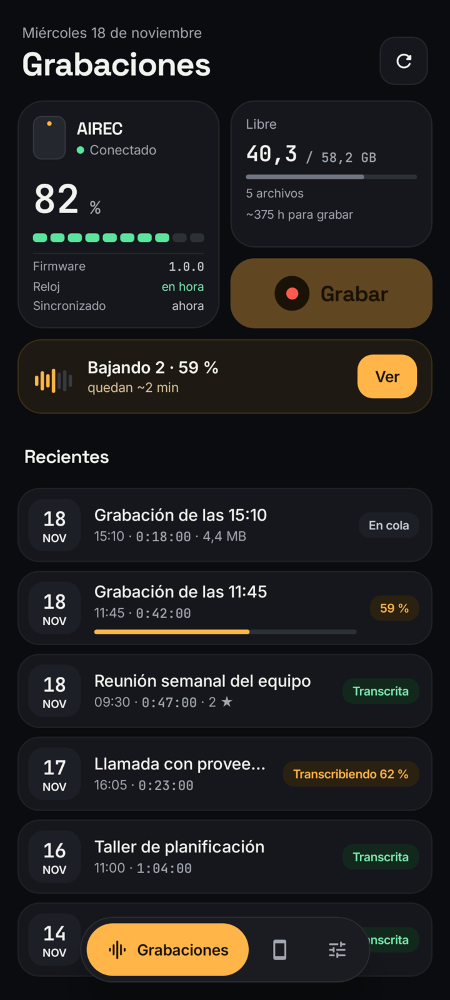
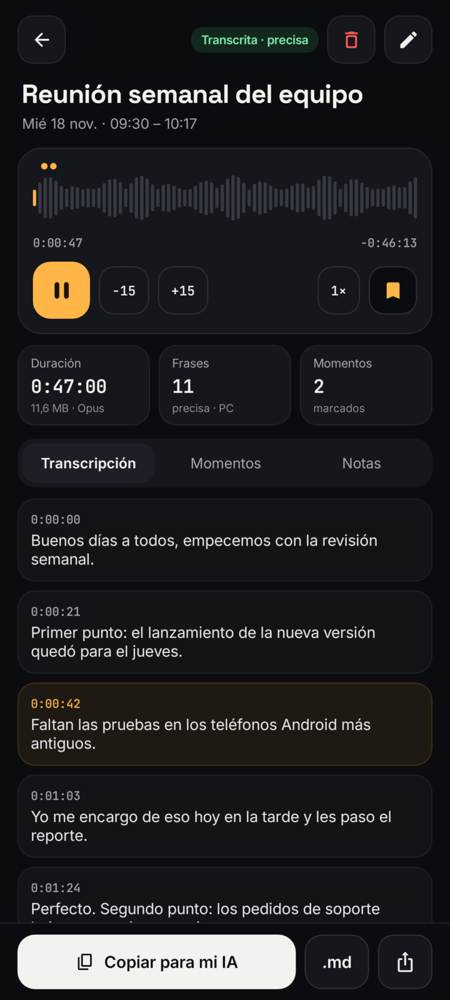
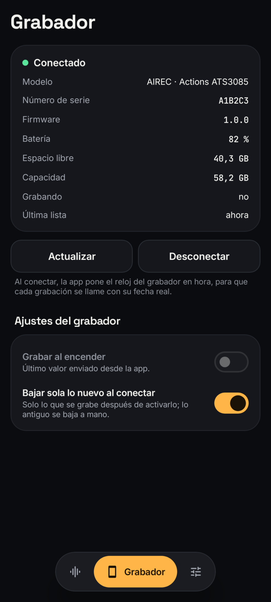

# airec-open

**Now you can have your own app to record meetings with the generic AIREC-type voice recorders.**
Download your recordings over Bluetooth and transcribe them on the phone — no account, no cloud,
no internet required.

[Español más abajo](#español)

<p align="center">
  
  
  
</p>
<p align="center"><sub>Screenshots with sample data.</sub></p>

## Why

AIREC-type recorders are cheap, generic Chinese voice recorders — great for meetings — but their
official app ties them to an account and a cloud service. airec-open talks to the recorder
directly over Bluetooth Low Energy, keeps the audio on your phone and transcribes it locally with
[whisper.cpp](https://github.com/ggml-org/whisper.cpp).

## Features

- Connect, see battery and free space, set the clock.
- Start and stop recording from the phone.
- List, download (in the background, with resume) and delete recordings.
- Recordings saved as standard Ogg Opus — open them with anything; share them from the app.
- **On-device transcription** with whisper.cpp: a fast model (small, 190 MB) or a precise one
  (large-v3-turbo, 574 MB), downloaded once. Follow the text while the audio plays.
- Optional: transcribe on a PC with faster-whisper (`pc/transcribir.py`) and send the text back to
  the phone over adb.

The interface is in Spanish for now. Translations are welcome.

## Supported devices

Tested with an AIREC recorder using the Actions ATS3085 chip (firmware 1.0.0, advertises as
`AIREC`, service `0011200a-…`). Other models may use a different chip and protocol. See
[docs/PROTOCOL.md](docs/PROTOCOL.md).

Phone: Android 13+ (arm64).

## Install

Download the APK from [Releases](../../releases) and install it (allow installing from unknown
sources).

## Build

```sh
git clone --recursive https://github.com/seto101/airec-open.git
cd airec-open
./gradlew assembleRelease     # needs Android SDK + NDK 27.2
```

If you already cloned without `--recursive`: `git submodule update --init`.

Release builds are signed only if `~/.config/grabador/firma.properties` exists (`storeFile`,
`storePassword`, `keyAlias`, `keyPassword`); otherwise you get an unsigned APK.

## Protocol

The BLE protocol was documented by observing and measuring the device for interoperability:
[docs/PROTOCOL.md](docs/PROTOCOL.md).

## Disclaimer

This is an independent, unofficial project. It is not affiliated with, endorsed by or connected to
AIREC or the device manufacturer. "AIREC" is used only to describe compatibility. Use at your own
risk.

## License

[MIT](LICENSE) © 2026 Seto Systems. Third-party components: [THIRD_PARTY.md](THIRD_PARTY.md).

---

## Español

**Ahora es posible tener tu propia app para grabar audio de reuniones con las grabadoras chinas
genéricas tipo AIREC.** Baja tus grabaciones por Bluetooth y transcríbelas en el propio teléfono,
sin cuenta, sin nube y sin internet.

Probada con el modelo de chip Actions ATS3085. Otras variantes pueden usar otro protocolo; si
tienes una, los aportes son bienvenidos.

- Conectar, ver batería y espacio, poner la hora.
- Grabar y detener desde el teléfono.
- Listar, descargar (en segundo plano, con reanudación) y borrar grabaciones.
- Audio en Ogg Opus estándar, para abrirlo con cualquier programa o compartirlo.
- **Transcripción en el teléfono** con whisper.cpp: modelo rápido (190 MB) o preciso (574 MB).
- Opcional: transcripción en la PC con `pc/transcribir.py`.

Instala la APK desde [Releases](../../releases) (Android 13 o superior). El protocolo está en
[docs/PROTOCOL.md](docs/PROTOCOL.md).

Proyecto independiente y no oficial, sin relación con AIREC ni con el fabricante.
Licencia [MIT](LICENSE).
